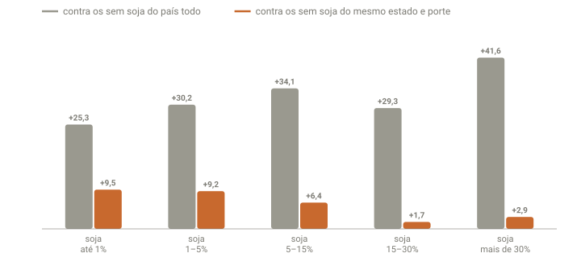
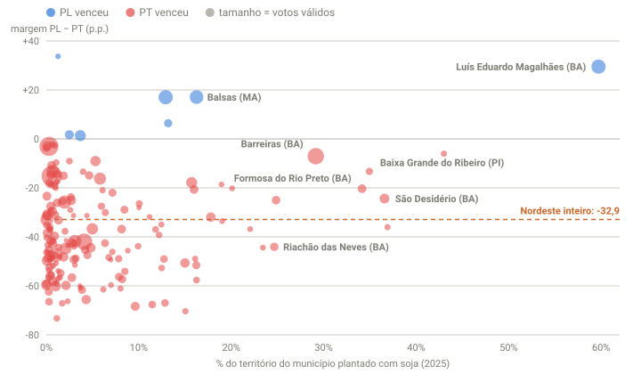

## Em resumo
- Circulou um post que punha lado a lado o mapa do 1º turno por município e o mapa da área plantada de soja: as manchas pareciam as mesmas. Para testar, juntei o resultado oficial dos 5.571 municípios com os dados de soja do IBGE.
- **No país, a semelhança existe.** Onde a soja ocupa mais de 15% do território (937 municípios, 11% dos votos), o Flávio abriu 3,4 milhões de votos, mais que a vantagem dele no Brasil (2,2 milhões).
- **Dentro de cada estado, ela quase desaparece.** Comparados aos municípios sem soja do mesmo estado e do mesmo porte, os de mais soja votaram só 2 a 3 p.p. mais no PL. No Sul, votaram menos.
- **O exemplo do post é a exceção da região.** Luís Eduardo Magalhães (BA) deu 62% ao Flávio, mas São Desidério e Formosa do Rio Preto, as duas maiores áreas de soja do Nordeste, deram cerca de 60% ao Lula. Dos 23 municípios do Nordeste com 15% ou mais do território em soja, o Flávio venceu em 2.
- **O que mudou de 2022 para 2026:** os municípios com soja se moveram mais para o PL do que os outros, sobretudo no Nordeste e no Norte.

## A pergunta
Um post comparava o mapa do voto por município com o mapa da soja, e as manchas azuis pareciam coincidir. Outro mostrava, no Google Earth, a divisa de Luís Eduardo Magalhães (BA), onde o Flávio venceu, com os municípios do Tocantins ao lado, onde o Lula venceu: de um lado, lavoura; do outro, cerrado. O mapa do voto é o mapa da soja?

## Para entender
- **Um mapa por município pinta área, não votos.** Um município grande do Mato Grosso ocupa mais tinta que a cidade de São Paulo. Aqui, todas as contas são ponderadas pelos votos válidos.
- **Soja no território** = área plantada de soja em 2025 (IBGE) ÷ área do município. Mede quanto da paisagem é soja, seja o município grande ou pequeno.
- **As regiões já votam diferente.** O Centro-Sul tem muita soja e vota mais no PL; o Nordeste tem pouca soja e vota mais no PT. Isso basta para os dois mapas se parecerem, mesmo que a soja não tenha relação nenhuma com o voto.
- Para separar uma coisa da outra, comparo cada município com os **municípios sem soja do mesmo estado e do mesmo porte** (até 10 mil, 10 a 50 mil, 50 a 200 mil e mais de 200 mil votos válidos). Se a soja separa o voto, a diferença continua grande mesmo nessa comparação.

## O que os dados mostraram
Resultado oficial do 1º turno por município (TSE), sem o exterior: Flávio 55.960.603 x Lula 53.722.151.

**1. No país, quanto mais soja, maior a margem do PL.**

| Soja no território | Municípios | % da área do país | % dos votos | Flávio | Lula | Margem PL − PT | Saldo PL − PT |
|---|---|---|---|---|---|---|---|
| sem soja | 2.933 | 47,4% | 63,2% | 41,6% | 51,1% | −9,6 | −7,19 mi |
| até 1% | 426 | 17,1% | 8,4% | 53,7% | 37,9% | +15,8 | +1,57 mi |
| 1–5% | 680 | 11,2% | 11,1% | 55,7% | 35,1% | +20,6 | +2,71 mi |
| 5–15% | 595 | 10,5% | 5,9% | 58,0% | 33,5% | +24,5 | +1,74 mi |
| 15–30% | 391 | 8,1% | 6,5% | 55,4% | 35,6% | +19,8 | +1,52 mi |
| mais de 30% | 546 | 5,7% | 4,9% | 62,3% | 30,3% | +32,0 | +1,88 mi |

Os municípios com mais de 15% do território em soja deram ao Flávio um saldo de **+3,41 milhões** de votos. No resto do país, o Lula ficou à frente por 1,17 milhão.

**2. Dentro do estado, a diferença quase some.**

**Como ler o gráfico:** cada par de barras é uma faixa de soja. A barra cinza mostra quanto a margem PL − PT da faixa é maior que a dos municípios sem soja **do país todo**. A laranja faz a mesma conta contra os municípios sem soja **do mesmo estado e do mesmo porte**. As barras cinza são altas (25 a 42 p.p.), e as laranja, baixas, menores justamente nas faixas com mais soja (1,7 e 2,9 p.p.). A maior parte da diferença vem do estado e do porte, não da soja.

| Soja no território | Contra os sem soja do país | Contra os sem soja do mesmo estado e porte, 2026 | O mesmo, 2022 | Municípios comparados |
|---|---|---|---|---|
| até 1% | +25,3 | +9,5 | +7,9 | 409 de 426 |
| 1–5% | +30,2 | +9,2 | +8,1 | 662 de 680 |
| 5–15% | +34,1 | +6,4 | +3,3 | 570 de 595 |
| 15–30% | +29,3 | +1,7 | −3,6 | 374 de 391 |
| mais de 30% | +41,6 | +2,9 | −3,0 | 523 de 546 |

Na comparação justa, mais soja não quer dizer mais PL: a diferença é maior nos municípios com **pouca** soja (+9) do que nos de muita (+2 a +3). Em 2022, os municípios de muita soja votaram até um pouco **menos** no Bolsonaro que os vizinhos sem soja.

**3. Por região, o quadro muda.**

| Região | Municípios com soja ≥ 5% | Margem dos sem soja | Margem dos com soja ≥ 5% | Diferença no mesmo estado e porte |
|---|---|---|---|---|
| Norte | 72 | −8,1 | +27,5 | +24,5 |
| Nordeste | 57 | −33,2 | −19,9 | +18,6 |
| Sudeste | 276 | +6,4 | +25,3 | +14,2 |
| Sul | 815 | +39,2 | +28,2 | −5,8 |
| Centro-Oeste | 312 | +17,6 | +25,7 | +6,8 |

- **No Sul**, onde mais há soja, os municípios **sem** soja votaram mais no PL que os com soja. Sete em cada dez desses votos estão em Santa Catarina (Joinville, Florianópolis, Blumenau, Itajaí); o resto, sobretudo na Serra Gaúcha e na Grande Porto Alegre.
- **No Norte e no Nordeste**, a diferença é grande. São as áreas de fronteira agrícola, como o Matopiba e Rondônia. Os dois itens a seguir olham de perto.

**4. Nordeste: a soja não decidiu o município.**

**Como ler o gráfico:** cada círculo é um município do Nordeste que planta soja. Quanto mais à direita, maior a parte do território com soja; acima de zero, o Flávio venceu (azul); abaixo, o Lula (vermelho). O tamanho do círculo é o número de votos válidos. A linha tracejada é a margem do Nordeste inteiro. Os municípios com mais soja se espalham dos dois lados da linha tracejada (13 dos 23 com 15% ou mais ficam acima dela, ou seja, o PL foi melhor lá que na média da região), mas quase todos ficam abaixo de zero. Luís Eduardo Magalhães, no canto superior direito, aparece isolado.

| Município | Soja (mil ha) | % do território | Flávio | Lula | Margem PL − PT 2026 | Margem 2022 |
|---|---|---|---|---|---|---|
| São Desidério (BA) | 554 | 36,6% | 35,7% | 60,1% | −24,4 | −41,3 |
| Formosa do Rio Preto (BA) | 534 | 34,1% | 37,8% | 58,2% | −20,3 | −44,3 |
| Baixa Grande do Ribeiro (PI) | 273 | 34,9% | 40,6% | 53,8% | −13,3 | −42,2 |
| Luís Eduardo Magalhães (BA) | 241 | 59,7% | 62,0% | 32,5% | +29,5 | +12,6 |
| Barreiras (BA) | 235 | 29,1% | 43,6% | 50,7% | −7,0 | −21,5 |
| Balsas (MA) | 214 | 16,2% | 55,5% | 38,4% | +17,1 | −8,5 |
| Uruçuí (PI) | 209 | 24,9% | 35,0% | 60,0% | −25,0 | −42,3 |
| Correntina (BA) | 205 | 17,8% | 31,0% | 63,0% | −31,9 | −52,2 |
| Tasso Fragoso (MA) | 188 | 43,0% | 44,3% | 50,3% | −6,0 | −33,4 |
| Riachão das Neves (BA) | 147 | 24,7% | 26,5% | 70,5% | −44,1 | −56,9 |

Os 10 municípios do Nordeste com mais área de soja. Dos 57 municípios da região com soja em 5% ou mais do território, o Flávio venceu em 4 (Açailândia, Balsas, Itinga do Maranhão e Luís Eduardo Magalhães). Com 15% ou mais, em 2 de 23.

**5. Luís Eduardo Magalhães e os vizinhos.**

| Município | Válidos | Flávio | Lula | Soja (% do território) | Nascidos no Sul |
|---|---|---|---|---|---|
| Luís Eduardo Magalhães (BA) | 62.061 | 62,0% | 32,5% | 59,7% | 6,6% |
| São Desidério (BA) | 22.217 | 35,7% | 60,1% | 36,6% | 2,9% |
| Formosa do Rio Preto (BA) | 16.106 | 37,8% | 58,2% | 34,1% | 1,1% |
| Barreiras (BA) | 85.750 | 43,6% | 50,7% | 29,1% | 1,4% |
| Riachão das Neves (BA) | 14.575 | 26,5% | 70,5% | 24,7% | 0,3% |
| Correntina (BA) | 21.051 | 31,0% | 63,0% | 17,8% | 0,6% |
| Jaborandi (BA) | 7.370 | 29,1% | 66,1% | 11,8% | 0,6% |
| Mateiros (TO) | 1.523 | 32,4% | 64,6% | 5,8% | 1,1% |
| Dianópolis (TO) | 10.009 | 39,3% | 53,6% | 3,6% | 1,1% |
| Ponte Alta do Bom Jesus (TO) | 2.798 | 36,2% | 57,5% | 1,2% | 0,3% |
| Novo Jardim (TO) | 1.745 | 35,2% | 59,3% | 0,9% | 0,5% |
| Taguatinga (TO) | 8.347 | 40,2% | 54,2% | 0,1% | 0,9% |
| Taipas do Tocantins (TO) | 1.405 | 26,0% | 69,3% | 0,1% | 1,2% |
| Aurora do Tocantins (TO) | 2.435 | 40,7% | 52,9% | 0,0% | 0,5% |

A imagem do post é verdadeira: Luís Eduardo Magalhães é lavoura, e o lado do Tocantins é cerrado. A divisa entre os dois estados, ali, acompanha a borda do chapadão. Mas a lavoura continua para o norte e para o sul, em São Desidério, Formosa do Rio Preto, Barreiras e Correntina, e esses municípios votaram no Lula, como o lado do Tocantins.

O que distingue Luís Eduardo Magalhães entre esses municípios é a **cidade**. É um município novo, emancipado de Barreiras em 2000 e formado em boa parte por migrantes do Sul que chegaram com a soja. No Censo 2022, 6,6% dos moradores nasceram no Sul, a maior proporção da Bahia e mais que o dobro de qualquer outro município do estado (São Desidério, o segundo, tem 2,9%).

**6. Uma pista: quem mora lá.**

| Região | Grupo | Municípios | Votos válidos | Margem PL − PT |
|---|---|---|---|---|
| Norte | soja ≥ 5%, nascidos no Sul ≥ 5% | 13 | 90 mil | +47,5 |
| Norte | soja ≥ 5%, nascidos no Sul < 5% | 59 | 836 mil | +25,3 |
| Norte | soja < 5%, nascidos no Sul ≥ 5% | 42 | 615 mil | +49,0 |
| Norte | soja < 5%, nascidos no Sul < 5% | 336 | 8.651 mil | −1,1 |
| Nordeste | soja ≥ 5%, nascidos no Sul ≥ 5% | 1 | 62 mil | +29,5 |
| Nordeste | soja ≥ 5%, nascidos no Sul < 5% | 56 | 769 mil | −23,9 |
| Nordeste | soja < 5%, nascidos no Sul < 5% | 1.737 | 32.874 mil | −33,2 |

- **No Norte**, os municípios com 5% ou mais de moradores nascidos no Sul votaram no PL por mais de 47 p.p., **com ou sem soja**. Os que têm soja e poucos migrantes do Sul ficaram em +25. Quase todos os municípios com muitos migrantes do Sul (50 de 55) são de **Rondônia**, ocupada por colonos do Sul a partir dos anos 1970. Lá, a atividade principal é a pecuária, mais do que a soja.
- **No Nordeste**, só Luís Eduardo Magalhães passa de 5%. Os outros 56 municípios com soja em 5% ou mais do território votaram no Lula por 24 p.p.

**7. De 2022 para 2026: onde o PL mais cresceu.**

| Soja no território | Margem PL − PT 2022 | 2026 | Variação |
|---|---|---|---|
| sem soja | −15,3 | −9,6 | +5,7 |
| até 1% | +8,0 | +15,8 | +7,8 |
| 1–5% | +12,2 | +20,6 | +8,4 |
| 5–15% | +13,1 | +24,5 | +11,4 |
| 15–30% | +10,4 | +19,8 | +9,4 |
| mais de 30% | +18,6 | +32,0 | +13,4 |

No país, a margem PL − PT passou de −5,2 (2022) para +1,9 (2026), uma variação de +7,1. Nos municípios com soja, a variação foi maior (+8 a +13). A diferença é mais clara na fronteira agrícola:

| Grupo | 2022 | 2026 | Variação |
|---|---|---|---|
| Nordeste, todos os municípios | −39,8 | −32,9 | +6,9 |
| Nordeste, soja ≥ 15% do território (23) | −29,9 | −11,7 | +18,2 |
| Norte, todos os municípios | −1,6 | +4,5 | +6,1 |
| Norte, soja ≥ 15% do território (23) | +1,1 | +16,7 | +15,6 |

Balsas (MA) passou de Lula +8,5 em 2022 a Flávio +17,1 em 2026; Tasso Fragoso (MA), de −33,4 para −6,0; Baixa Grande do Ribeiro (PI), de −42,2 para −13,3.

## Como calculei
- **Votos:** dados abertos do TSE, `votacao_partido_munzona_2026.zip` e `_2022.zip` (arquivo `*_BR.csv`, Presidente, 1º turno), somando as zonas de cada município: votos válidos, PL (22) e PT (13). Sem o exterior. Com o exterior, os totais batem com o resultado oficial (56.104.503 x 53.879.538).
- **Código TSE → IBGE:** lista de municípios do próprio TSE (`mun-e006257-cm.json`), que traz o código do IBGE de cada um.
- **Soja:** IBGE, Produção Agrícola Municipal 2025, tabela 5457 (área plantada ou destinada à colheita, soja em grão).
- **Área:** Censo 2022, tabela 4714. Boa Esperança do Norte (MT), criado depois do Censo, pela API de malhas do IBGE.
- **Nascidos no Sul:** Censo 2022, tabela 631 (população residente por lugar de nascimento).
- **Mesmo estado e porte:** para cada município com soja, a margem dele menos a margem do conjunto dos municípios sem soja da mesma UF e do mesmo porte; a média de cada faixa é ponderada pelos votos válidos. Os municípios sem nenhum vizinho sem soja do mesmo porte no estado (4% dos que têm soja) ficam de fora dessa comparação.
- `python3 analise/municipios.py` baixa tudo (com cache), gera `dados/export/municipios.csv` (uma linha por município) e imprime as tabelas deste case. Os gráficos saem de `analise/graficos.py`.

**Limitações:**
- **São municípios, não pessoas.** Um município com muita soja não é um município de produtores de soja; a maior parte dos eleitores pode não ter relação direta com a lavoura.
- **Soja não é todo o agro.** Pecuária, milho, algodão e cana ficaram de fora. Em Rondônia, por exemplo, o peso é da pecuária.
- **O Censo conta quem nasceu no Sul, não os filhos de migrantes** nascidos no destino. Em cidades como Luís Eduardo Magalhães, a origem sulista é maior do que os 6,6% sugerem.
- **Um erro na fonte:** o IBGE registra em Mariópolis (PR) 45 mil ha de soja, mais que os 23 mil ha do município. Ele fica na faixa de mais de 30% de qualquer jeito.

## Conclusão
- **Os dois mapas se parecem porque seguem a mesma divisão regional.** O Centro-Sul, com muita soja, vota mais no PL; o Nordeste, com pouca, vota mais no PT. Dentro de cada estado, a soja separa pouco o voto: 2 a 3 p.p. nos municípios de muita soja, e no Sul a relação se inverte.
- **O exemplo de Luís Eduardo Magalhães é a exceção da região.** As maiores áreas de soja do oeste baiano votaram no Lula. O que separa Luís Eduardo Magalhães dos vizinhos não é a lavoura, que é parecida, e sim a cidade e quem mora nela.
- **A origem dos moradores separa o voto mais que a soja,** pelo menos no Norte, onde quase tudo é Rondônia.
- **A soja aparece mais na mudança do que no nível.** De 2022 para 2026, os municípios com soja se moveram mais para o PL que os outros. No Nordeste e no Norte, os de mais soja andaram cerca de 2,5 vezes a variação da região.

## Desfecho
_2º turno (25/10): refazer com o resultado do 2º turno. A soja e a origem dos moradores continuam separando o voto do mesmo jeito?_
